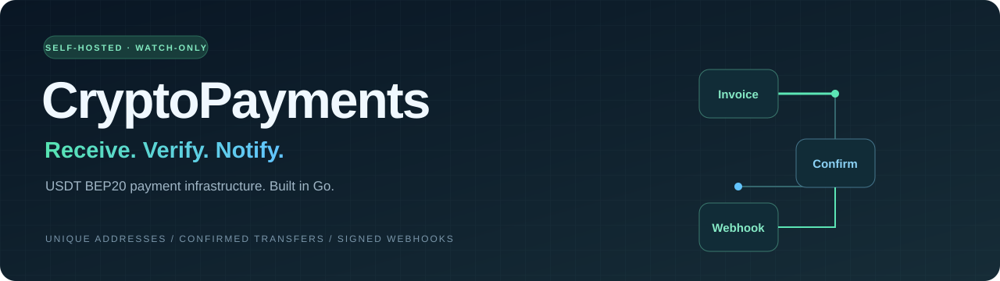

<p align="center">
  
</p>

<p align="center">
  <a href="go.mod"></a>
  
  
  
</p>

# CryptoPayments

Self-hosted Go API for receiving **USDT BEP20** payments on BNB Smart Chain.
Create an invoice, receive funds at a unique address, and get confirmed payment
status through the API or a signed webhook. An optional signer collects funds
to your main wallet.

[Quick start](#quick-start) · [API](#api) · [Automatic collection](#automatic-collection) · [Full guide](docs/guide.md)

## Features

- **Unique addresses:** a fresh HD deposit address for every invoice, derived from an xpub.
- **Reliable accounting:** partial payments accumulate; confirmed total ≥ requested amount means paid.
- **Confirmed payments:** matching token and recipient, block finality and confirmation depth are all required.
- **Persistent state:** SQLite stores invoices, transfer records, scan cursors and the webhook outbox.
- **Signed delivery:** HMAC webhooks with retries and per-invoice event ordering.
- **Optional collection:** a separate signer funds child-wallet BNB gas and transfers USDT to your main wallet.

## Architecture


The HTTP API, scanner and webhook dispatcher share one Go process. The API is
watch-only; only the optional sweep process mounts the deposit seed and gas-wallet
key. Both processes use the same SQLite database.

## Quick start

Requires **Docker Compose** and **Python 3**. Build the binary, then start and test
an isolated local EVM with disposable test tokens:

```sh
docker run --rm -v "$PWD:/src" -w /src golang:1.25-bookworm \
  sh -c 'go build -o bin/cryptopayments .'
python3 scripts/local_test.py setup
python3 scripts/local_test.py test
```

The API runs at `http://127.0.0.1:18090`. Setup writes an ignored `.env` with a
random `API_KEY`. This uses local Anvil, not public BSC Testnet.

## API

All `/v1/*` routes require `Authorization: Bearer <API_KEY>`. Amounts are JSON strings.

```sh
curl http://127.0.0.1:18090/v1/invoices \
  -H "Authorization: Bearer $API_KEY" \
  -H 'Content-Type: application/json' \
  -d '{"order_id":"order-1001","amount":"25.50"}'
```

| Method | Endpoint | Purpose |
| --- | --- | --- |
| `POST` | `/v1/invoices` | Create an invoice; retrying the same order and amount returns it |
| `GET` | `/v1/invoices/{id}` | Read payment status and confirmed transfers |
| `GET` | `/v1/invoices/{id}/sweeps` | Read collection jobs and transaction hashes |
| `GET` | `/v1/status` | Read scanner and sweep-worker status |
| `GET` | `/healthz` · `/readyz` | Process liveness and scanner readiness |

For a 10 USDT invoice, 4 + 6 is paid and 12 is overpaid; both set `is_paid=true`.
Late payments retain a separate status. Deduplicate fulfilment by invoice ID.

## Automatic collection

Configure `MAIN_WALLET_ADDRESS`, the matching deposit seed and a dedicated gas-wallet
key, then opt in with `AUTO_SWEEP_ENABLED=true` and the Compose `sweep` profile.
The signer supplies BNB when needed, persists signed transactions before broadcast,
and verifies the outgoing USDT transfer. The main wallet's private key is not required.

[Collection setup and limits →](docs/guide.md#automatic-collection-to-your-main-wallet)

## Documentation

[Full guide](docs/guide.md) · [OpenAPI contract](openapi.yaml) · [Environment variables](.env.example) ·
[Webhooks](docs/guide.md#webhooks) · [Development checks](docs/guide.md#development-checks)

Local payment and signed-collection tests pass. Public-network and real-money
validation are still pending.
